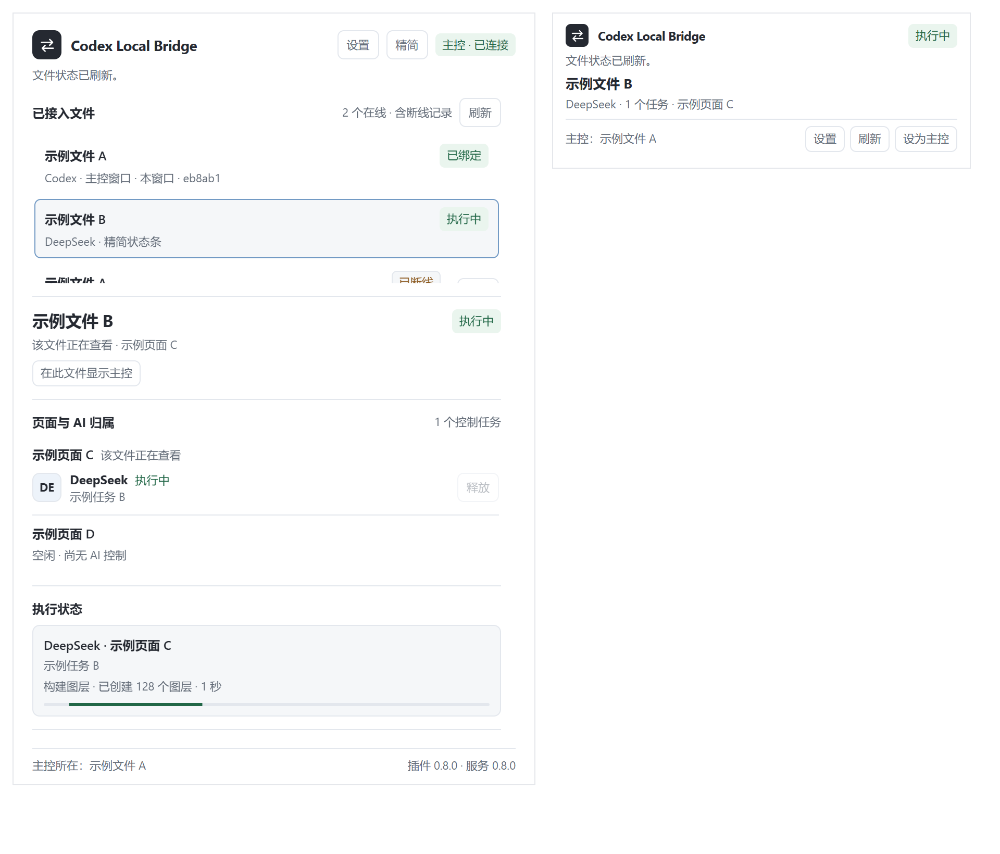

# Codex Local Bridge

### 和 AI 对话，在 Figma 中完成设计。

连接你的 AI 助手与 Figma Desktop，读取设计、创建可编辑图层、修改界面并检查结果。多个 AI 可以分别负责不同页面，你在同一个面板里查看文件、任务和执行进度。

[](https://github.com/mengkong30/codex-local-bridge/releases/latest)
[](https://github.com/mengkong30/codex-local-bridge/actions/workflows/check.yml)
[](LICENSE)

**[下载安装](https://github.com/mengkong30/codex-local-bridge/releases/latest)** · [快速开始](#快速开始) · [使用示例](#可以这样开始) · [能力范围](docs/CAPABILITIES.md) · [更新记录](CHANGELOG.md)



<sub>插件界面截图，使用合成示例数据。左侧为统一主控，右侧为另一文件的精简状态条。</sub>

## 从一句需求，到可以继续编辑的图层

> “在当前页面创建一组指标卡和折线图，保持统一的字体、配色和间距。”

AI 通过桥接工具读取目标页面、执行设计命令，并将结果留在 Figma 中。文字、形状、Frame、组件和图表可以继续选择与编辑；你也可以让 AI 读取已有设计，做下一轮调整。

**无需 Figma API 密钥 · 本机桥接 · 支持多文件 · 运行时无 npm 第三方依赖**

**0.8.3 · 2026-10-26：** 优化结构快照，修复跨自动布局移动后撤销误删子图层的问题；15 组隔离测试及 Windows Figma Design 实机验收通过，覆盖双向单步/批量撤销、子图层保留、冲突保护和失败回滚。[更新公告](docs/ANNOUNCEMENTS.md) · [验收范围](docs/LIVE-VALIDATION-2026-10-26.md) · [更新记录](CHANGELOG.md)。

**0.8 功能：** 通用图层与矢量操作、完整字段清单、文字范围编辑、变量模式、原型写入、JPG/PDF 导出，以及 FigJam、Slides 与 Dev Inspect 接口。[查看新命令与示例](docs/EXPANDED-API.md)。

## 为持续迭代设计准备

### 多个 AI，各自负责明确的页面

让一个任务处理桌面端，另一个任务处理移动端。每个 AI 先绑定自己的页面，插件检查写入目标；你切换当前查看的页面，也不会把正在执行的任务带到其他页面。同一文件的命令按顺序执行，不同文件可以独立工作。

### 一个主控，看到所有已接入的任务

主控面板汇总已连接文件、页面归属和执行状态。其他文件里的插件收成精简状态条，继续接收任务与回传结果。可以切换主控、手动刷新和清理断线记录，每份目标文件仍需打开插件。

### 修改前可预览，修改后可检查

复杂修改可以先预演，查看计划中的变动；执行后返回变更记录，支持范围内的操作可以撤销。截图审阅把结果交回当前 AI，结合布局检查继续修正遮挡、裁切和对齐问题。遇到超时，先查询原操作结果，避免重复写入。

## 可以这样开始

把目标页面和需求告诉支持工具调用的 AI 助手：

**搭建一个可编辑页面**

> “连接本地 Figma，在‘概览’页面创建一个宽 1440 的 Frame，包含 4 张指标卡和一张折线图。先确认目标，再开始创建。”

**调整已有设计**

> “读取当前选中的卡片，把标题字号改成 20、正文改成 14，文字左对齐。修改后回读属性并导出预览。”

**检查画面并继续修正**

> “检查这个 Frame 的文字裁切、遮挡和对齐问题，截图审阅后修复能够确定的问题，再给我看结果。”

**让不同任务分工**

> “这个任务只负责‘移动端’页面。绑定后显示任务名‘移动端排版’，完成后释放绑定。”

这些是任务示例，实际结果取决于 AI 的规划、文件内容和当前支持的命令。插件提供读取、执行与检查能力，设计判断由调用它的 AI 完成。

## 你能用它做什么

| 工作 | 插件提供的能力 |
| --- | --- |
| 了解已有设计 | 读取文档、页面、选区、节点树、字体、样式、变量与已启用库的变量集合 |
| 搭建界面 | 创建原生图层、矢量、组件与图表；复制、移动、排序、分组和布尔运算 |
| 组织设计基础 | 管理本地变量、多模式、颜色/网格/文字/效果样式，导入库资产及修改组件实例 |
| 检查与交付 | 布局检查、截图审阅、有界修复、原型交互写入及 PNG / SVG / JPG / PDF 导出 |
| 管理 AI 任务 | 页面或独占文件绑定、进度查看、主控切换、操作结果查询 |

详细字段和未覆盖能力见 [能力范围](docs/CAPABILITIES.md) 与 [API 文档](docs/API.md)。

## 快速开始

准备 **Figma Desktop、Node.js 22+ 和支持本地 stdio MCP 的 AI 客户端**。Codex 插件包和通用 MCP 配置都在仓库中；其他宿主的安装方式取决于它自己的 MCP 支持。

### 1. 下载并连接 AI 客户端

下载 [最新 Release ZIP](https://github.com/mengkong30/codex-local-bridge/releases/latest) 并解压。支持插件包的宿主使用包内配置；通用 MCP 客户端可加入：

```json
{
  "mcpServers": {
    "codex-local-bridge": {
      "command": "node",
      "args": ["/absolute/path/to/codex-local-bridge/mcp-server.mjs"]
    }
  }
}
```

将路径替换为实际绝对路径，然后让客户端重新加载 MCP。无需安装 npm 依赖或构建即可使用发布包。

### 2. 在 Figma 中运行插件

打开目标文件，选择 **Plugins → Development → Import plugin from manifest**，导入解压目录里的 `figma/manifest.json`，运行 **Codex Local Bridge** 并保持窗口打开。

### 3. 发出第一个任务

> “连接本地 Figma，列出已连接文件和页面，读取当前选区。”

确认读到了目标文件后，就可以继续创建或修改设计。写入前 AI 需要绑定明确的目标页面。首次安装、Windows 路径、连接故障与升级步骤见 [安装指南](docs/GETTING-STARTED.md)。

## 使用范围

支持 **Figma Design** 的结构化读写，并提供 **FigJam** 便签/形状/连线/表格、**Slides** 幻灯片/网格/转场和独立的 **Dev Inspect** 只读入口。能力取决于编辑器、Figma 版本和文件权限；这不代表全部 Figma API 均已封装。[查看具体范围](docs/CAPABILITIES.md)。

桥接服务只监听本机回环地址，无身份鉴权，适合可信的个人设备。若使用云端 AI，模型处理的设计内容仍可能离开本机。回滚、撤销和自动修复均有明确支持范围，详见 [安全说明](SECURITY.md)、[隐私说明](PRIVACY.md) 和 [可靠写入](RELIABILITY.md)。

## 文档与开发

| 文档 | 内容 |
| --- | --- |
| [安装指南](docs/GETTING-STARTED.md) | 配置、连接、升级与常见问题 |
| [能力范围](docs/CAPABILITIES.md) | 已支持功能、部分支持项与限制 |
| [多 AI 控制](CONTROLLERS.md) · [主控面板](HUB.md) | 页面分工、进度与显示切换 |
| [高层构建](DSL.md) · [视觉复检](VISUAL-REVIEW.md) | 可编辑构建与截图检查流程 |
| [扩展 API](docs/EXPANDED-API.md) · [API](docs/API.md) · [测试](docs/TESTING.md) | 接口边界与验证方式 |

```sh
npm run check
npm test
npm run scan
```

修改 Figma 源模块后运行 `npm run build`。可选 UI 测试及覆盖范围见 [测试说明](docs/TESTING.md)。欢迎通过 [Issues](https://github.com/mengkong30/codex-local-bridge/issues) 提交脱敏的复现或使用建议。

---

[MIT License](LICENSE) · 独立社区项目，与 OpenAI、Figma 无官方关联。第三方软件、字体、设计和商标各自遵循其授权，详见 [免责声明](DISCLAIMER.md)。
